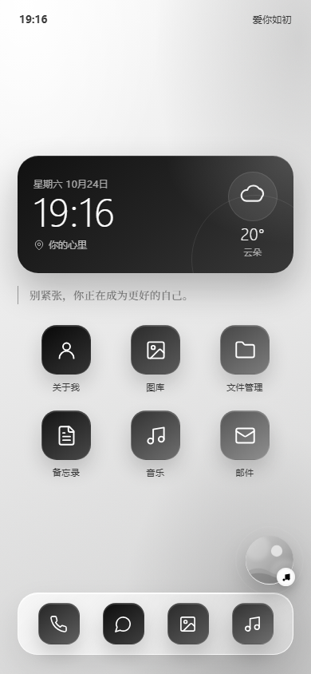

# 我的世界 · 静态个人主页

一个可以直接放在 GitHub Pages 上的「手机式」个人主页。锁屏、主屏幕、图库、文件、备忘录、邮件、联系人、信息和音乐播放器都可以在浏览器里直接浏览，没有后端，也不需要构建工具。



页面只保留浏览和演示功能：没有账号入口，也没有编辑、删除、排序或任何会写入浏览器的内容修改入口。所有内容都来自仓库里的静态文件。

配色为黑白灰。图片在页面上统一以灰度显示。

## 本地预览

在项目目录运行：

```bash
python -m http.server 8000
```

然后访问 `http://localhost:8000`。

也可以直接双击 `index.html`，但浏览器对 `file://` 下的音频自动播放限制较多，建议使用本地服务器预览。

## 部署到 GitHub Pages

1. 在 GitHub 新建一个仓库，把本项目所有文件推送到 `main` 分支。
2. 打开仓库的 `Settings` → `Pages`。
3. 在 `Build and deployment` 中选择 `Deploy from a branch`。
4. 分支选择 `main`，目录选择 `/ (root)`，点击 `Save`。
5. 等待一到两分钟，访问页面顶部显示的地址。

地址通常是：

```text
https://你的用户名.github.io/仓库名/
```

如果仓库名是 `你的用户名.github.io`，地址则是 `https://你的用户名.github.io/`。

之后每次修改文件并推送到 `main`，GitHub Pages 都会自动更新。

项目根目录的 `.nojekyll` 会让 GitHub Pages 按普通静态文件发布，不再经过 Jekyll 处理。

## 修改内容的位置

所有个人内容、图片路径和音乐路径集中在 `content.js`。

| 想修改的内容 | 文件与位置 | 相关素材 |
| --- | --- | --- |
| 浏览器标题与页面简介 | `index.html` 第 9 行 `<title>`、第 7 行 description | 无 |
| 姓名、标签、头像、个人签名 | `content.js` 第 6 行 `profile` | 头像：`assets/avatar.svg` |
| 状态栏右上角文字 | `content.js` 第 13 行 `statusText` | 无 |
| 锁屏通知标题与内容 | `content.js` 第 15 行 `lock` | 无 |
| 主屏随机短句 | `content.js` 第 20 行 `motds` | 无 |
| 天气与温度 | `content.js` 第 33 行 `weather` | 无 |
| 图库分类与照片 | `content.js` 第 43 行 `gallery` | 图片：`assets/photos/` |
| 音乐曲目 | `content.js` 第 63 行 `music.tracks` | 音频：`assets/music/`；封面：`assets/covers/` |
| 备忘录 | `content.js` 第 72 行 `memos` | 无 |
| 邮件 | `content.js` 第 80 行 `mails` | 配图：`assets/photos/` |
| 联系人卡片 | `content.js` 第 107 行 `contacts` | 无 |
| 信息页预设对话与自动回复 | `content.js` 第 113 行 `chat` | 无 |
| 整体黑白灰配色 | `style.css` 第 1 行 `:root` 颜色变量 | 无 |

替换图片时，把图片放进 `assets/photos/`，再修改 `content.js` 里对应的 `src`。支持浏览器可以显示的格式，例如 `.svg`、`.jpg`、`.png`、`.webp`。

替换音乐时，把音频放进 `assets/music/`，再修改 `content.js` 里对应的 `src`；封面放进 `assets/covers/` 并修改 `cover`。支持浏览器可以播放的格式，例如 `.mp3`、`.m4a`、`.wav`、`.ogg`。

照片、头像和音乐封面会在页面上自动转为灰度。如果以后想保留图片原本的颜色，可以删除 `style.css` 中 `img` 规则里的 `filter: grayscale(1);`。

## 页面与交互

- 锁屏：上滑解锁，也可以点击「上滑解锁」。
- 主屏：随机天气与短句；应用入口和底部 Dock。
- 关于我：头像、姓名、标签、签名和内容统计。
- 图库：两列瀑布流，底部按分类筛选；点击图片放大查看。
- 文件管理：图片与音乐列表，支持搜索和切换分类；点击图片查看，点击音乐播放。
- 备忘录：只读展示条目和完成状态。
- 邮件：收件箱与邮件详情，支持配图。
- 联系人：只读卡片。
- 信息：点击输入框会出现预设句子，发送后会收到自动回复。
- 音乐：上一首、下一首、播放暂停、进度拖动和播放列表。
- 手势：主屏与「关于我、备忘录、邮件、信息、图库」之间可以左右滑动切换。

浏览器会限制自动播放。页面首次打开时可能处于静音播放状态，轻触页面任意位置后会开启声音。

## 文件结构

```text
index.html          页面骨架
style.css           全部黑白灰样式
content.js          可修改的内容数据
app.js              页面渲染、手势、聊天与音乐播放逻辑
assets/avatar.svg   头像
assets/photos/      图库照片与邮件配图
assets/covers/      音乐封面
assets/music/       内置音频
preview.png         README 页面预览图
.nojekyll           GitHub Pages 发布配置
.gitignore          系统文件忽略规则
```

## 说明

这是一个纯静态站点，没有账号系统、数据库或服务器逻辑。展示给访客的内容在构建前就已经确定，访客只能浏览、播放和使用演示交互，所有内容都不会保存。

旧版本保存在浏览器里的本地修改不会再被读取；如果之前改过内容，请把最终文字写回 `content.js`。

页面内置的音频为本地合成氛围音，可自由替换。
